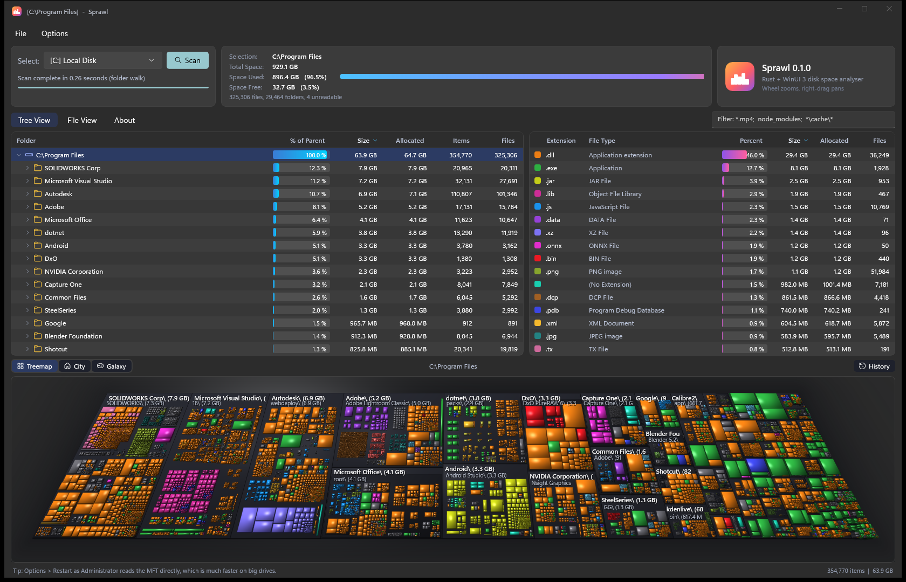
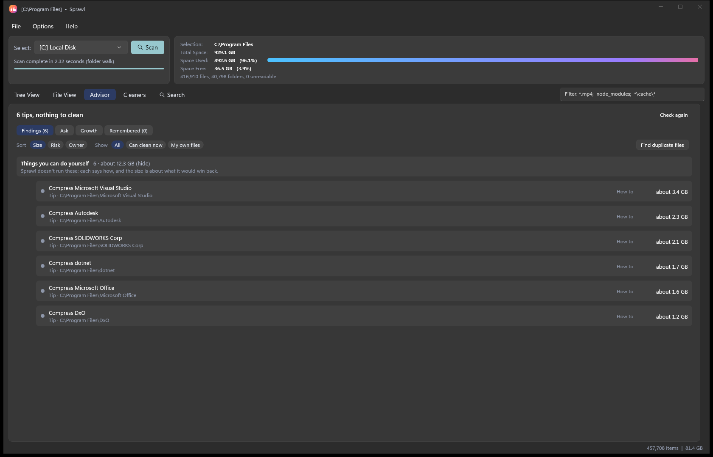
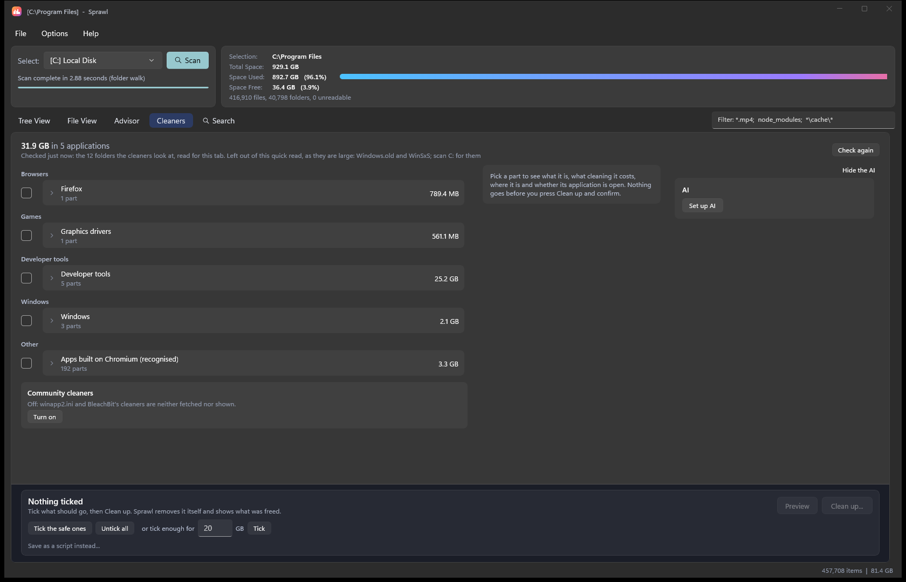
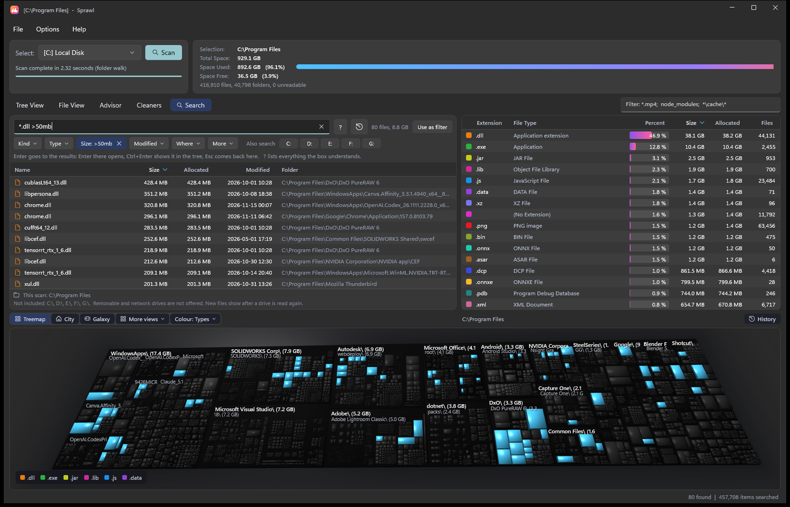

<p align="center">
  
</p>

<h1 align="center">Sprawl</h1>

<p align="center">
  See what fills your disk, then clear it safely.<br>
  A disk space analyser, cleaner and file search for Windows, in Rust and WinUI 3.
</p>

<p align="center">
  <a href="https://github.com/Kaan88/sprawl/releases/latest">Download</a> ·
  <a href="CHANGELOG.md">What's new</a> ·
  <a href="#building">Build it</a>
</p>



## What it does

**Explore.** Scan a drive or a folder and see where the space went: a sortable tree, the biggest
files, a table of file types, and a treemap you can zoom into (with City and Galaxy views).
As administrator Sprawl reads the NTFS file table directly, which takes seconds for a whole
drive; otherwise it walks the folders on every core.

**Advisor.** What can go, and why. Each finding has a risk, what it costs to get back, and
the evidence behind it: caches, build outputs of idle projects, folders left behind by removed
applications, old installers. On a drive of games or media it lists the big things nothing has
changed in for a year, as information. Nothing is ticked for you, and you review before anything
is removed.



**Cleaners.** Each application with the parts it keeps that can go (caches, logs, crash dumps),
in the manner of BleachBit. The tab reads only the folders the cleaners look at, so it works
without a scan. Preview lists exactly what would go. Privacy cleaners (browser cookies and
history, per profile) are off until you switch them on, and are never mixed with space cleaning.



**Search.** File names in the scan and, when you switch them on, your other drives. Filters
under the box write the query for you; the query language covers extensions, sizes, dates,
paths and regular expressions (`ext:iso size:>1gb dm:lastmonth`). Saved and recent searches.



**Optional AI.** Off by default. With Claude, Claude Code or an OpenAI-compatible server
(a local model works), it names folders the rules don't know and suggests what to tick. It
never deletes, never ticks, and what it adds is checked against the scan like any other finding.

## How it keeps a clean-up safe

- A never-list protects Windows, program installations, profiles, mail stores, password
  managers, messengers and browser profiles. Sprawl won't delete them or a folder that holds them.
- Every item is checked when it is found and again just before it goes. Anything created or
  changed since the scan, and anything you chose to keep, is left alone.
- Links are removed as links: what they point to is not touched.
- Your own files go to the Recycle Bin (a setting, on by default). Caches are deleted, since in
  the bin they would free nothing.
- A part whose application must be closed is held back while it is open, and the result says
  which program to close.
- Sprawl is not an uninstaller: it hands an application to Windows' Installed apps, to Steam, or
  to a program you choose ([how](docs/uninstaller-handoff.md)).
- Nothing leaves your PC unless you turn it on: the AI, community cleaner definitions and the
  daily update check each have a switch, and "Work offline" stops them all.

## Install

Download `Sprawl-Setup-<version>.exe` from the
[latest release](https://github.com/Kaan88/sprawl/releases/latest) and run it. It installs for
you only, in `%LOCALAPPDATA%\Programs\Sprawl`, with a Start menu entry and an entry in
Settings > Apps for uninstalling. No administrator rights are needed. Sprawl needs the Windows
App Runtime 1.8; if it's missing, Windows offers to install it the first time Sprawl starts.

Sprawl looks for a new version once a day and asks before updating (Help > Check for Updates;
Settings > Network turns the daily check off). Updates are signed: a copy only accepts a release
whose file list carries Sprawl's Ed25519 signature and whose files match it.

## Building

Requirements: Rust (MSVC toolchain), Visual Studio Build Tools, and the
[Windows App Runtime 1.8](https://learn.microsoft.com/windows/apps/windows-app-sdk/downloads).

```powershell
powershell -NoProfile -ExecutionPolicy Bypass -File tools\setup.ps1   # once: fetch SDK packages into sdk\
cargo build --release
.\target\release\sprawl.exe [folder]
```

Tests:

```powershell
cargo test --release -p sprawl-core -p sprawl-advisor -p sprawl-install -p sprawl
```

The tests delete nothing outside a temporary folder, call no AI provider and download nothing.

`sprawl --screenshot out.png [folder]` scans, saves a picture of the window and exits: handy for
checking the look without clicking around. The screenshots above were made this way.

To use a WinUI type or member that isn't projected yet, add it to `crates/bindgen/types.txt` and
run `cargo run -p sprawl-bindgen` (needs the Windows SDK 10.0.26100 metadata).

## Layout

```
crates/
  sprawl-core/      no UI: scanning (MFT and folder walk), the tree, file-type stats, the treemap
                    layout, the filter, the search index and query language (query.rs, compact.rs)
  sprawl-advisor/   no UI: what can go and how it goes
    rules.rs, rules/builtin.toml   the built-in rules and cleaners
    cleaners.rs, chromium.rs, leftovers.rs, projects.rs, stale.rs, facts.rs   what is found, and what it belongs to
    safety.rs       the never-list and the checks every finding passes
    clean.rs, recycle.rs, privacy.rs   the clean-up itself: delete, Recycle Bin, privacy file sets
    memory.rs, community.rs        your choices, your own and downloaded cleaner definitions
    history.rs, growth.rs, snapshot.rs   scan history
    llm/, mcp.rs    the optional AI: providers, its tools, the MCP server for Claude Code
    mcp_scan.rs     the MCP server's own scans (scan_path) and the trees it answers from
  sprawl/           the WinUI 3 app (XAML built at run time, the map drawn with Direct3D)
    main.rs, state.rs, commands.rs, ui.rs   start-up, window state, commands, the window's markup
    tables.rs, treemap.rs, views/           the tree, file and type tables; the map and its views
    advisor.rs, cleaners.rs, cleanup.rs     the Advisor and Cleaners tabs, the review and the run
    search.rs, search_box.rs, search_more.rs   the Search tab, its chips, other drives
    prefs.rs, wizard.rs, settings.rs        every setting described once; Settings and the wizard
    look.rs, admin.rs, shellmenu.rs, update.rs   shared styles, administrator switches, the Windows menu, updates
    bindings.rs     generated WinUI projection: do not edit by hand
  sprawl-install/   signed release manifest, swapping an update in, the Apps entry
  sprawl-release/   builds, signs and publishes a release
  bindgen/          regenerates bindings.rs from the SDK metadata
tools/              setup.ps1 (fetch the SDK packages), probe.ps1 (check the build environment)
installer/          the Inno Setup script
docs/               plans, audits, the uninstaller hand-off, screenshots
```

## Releasing

1. Raise `version` in `Cargo.toml` (`[workspace.package]`) and add a `## <version>` section to
   `CHANGELOG.md`. Commit and push.
2. Build the release tool on its own, then let it build, sign and publish:

```powershell
cargo build --release -p sprawl-release
.\target\release\sprawl-release build     # builds Sprawl, signs, makes the installer with Inno Setup 7, fills dist\v<version>
.\target\release\sprawl-release publish   # creates the GitHub release (needs gh)
```

The signing key is `%USERPROFILE%\.sprawl-release\signing.key`, made once with
`sprawl-release keygen`. It never goes in the repository. Its public half is `PUBLIC_KEY` in
`crates/sprawl-install/src/lib.rs`; losing the key means installed copies can't take updates
any more (they would need a new installer), so keep a copy somewhere safe.

To try an update on a build that is already current, start it with
`SPRAWL_PRETEND_VERSION=0.0.1`; it then sees the latest release as new.

## Not built, and what is planned

Not built on purpose: an uninstaller, registry cleaning, secure wiping, scheduled cleaning.

Planned: [future features](docs/plans/future-features.md) (compressing program folders, older
versions side by side, shrinking virtual disks, duplicates resolved by linking, a headless
report, a low-space alert) and [where the Advisor could go next](docs/plans/advisor-next.md).
The audit behind version 0.3.0 is in [docs/plans](docs/plans).

## Licence

MIT.
